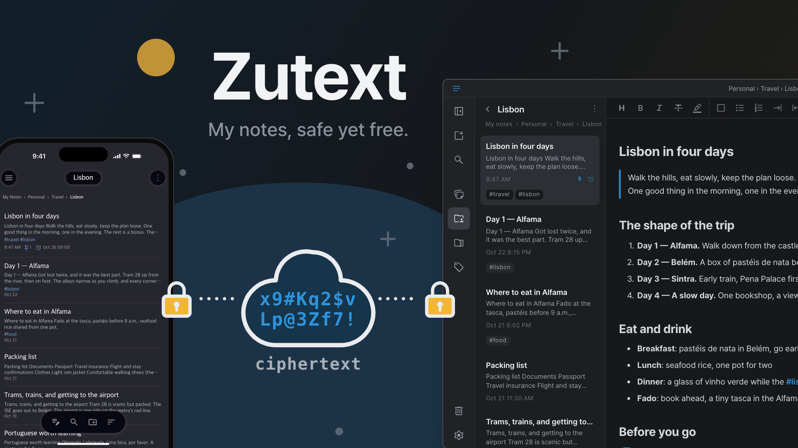
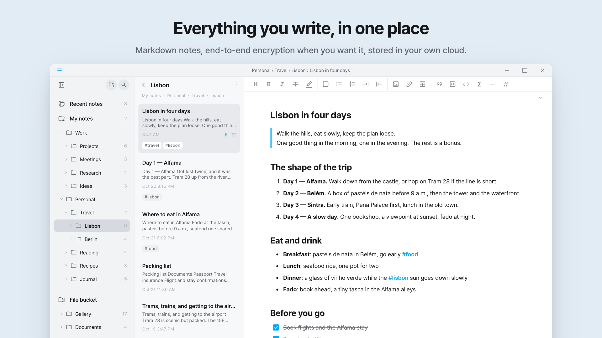
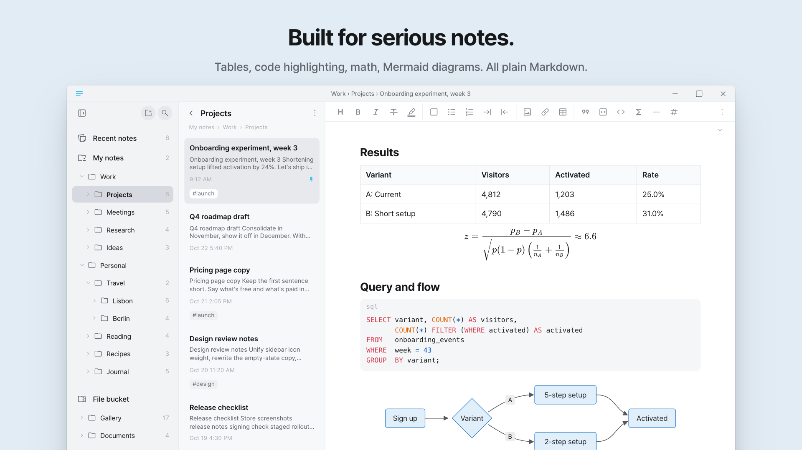
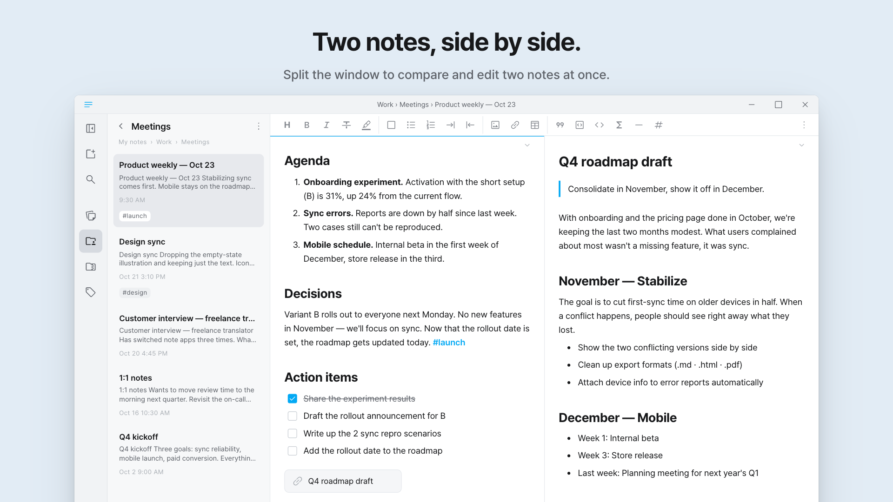
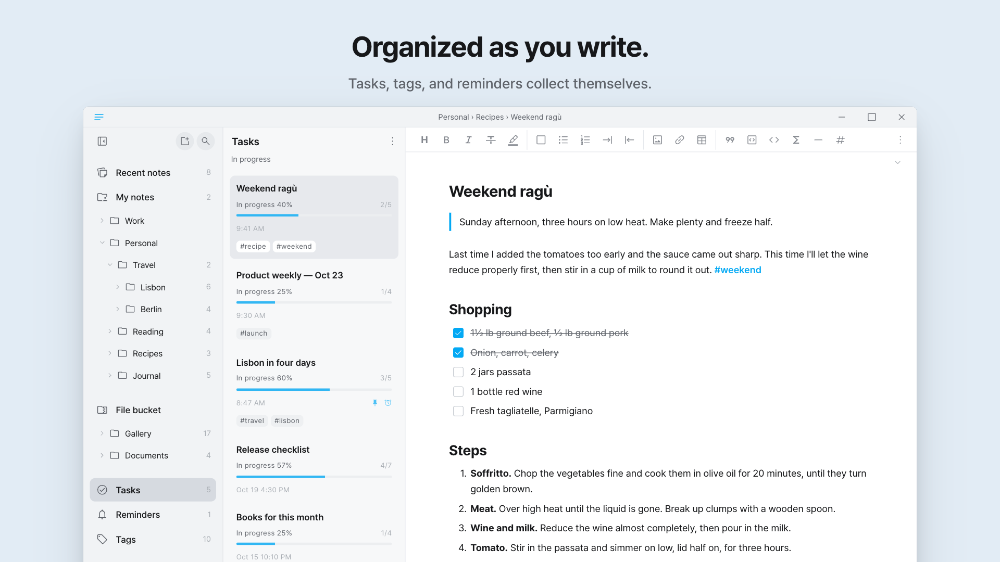
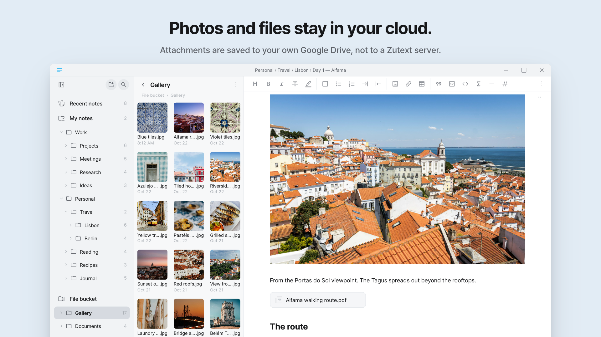
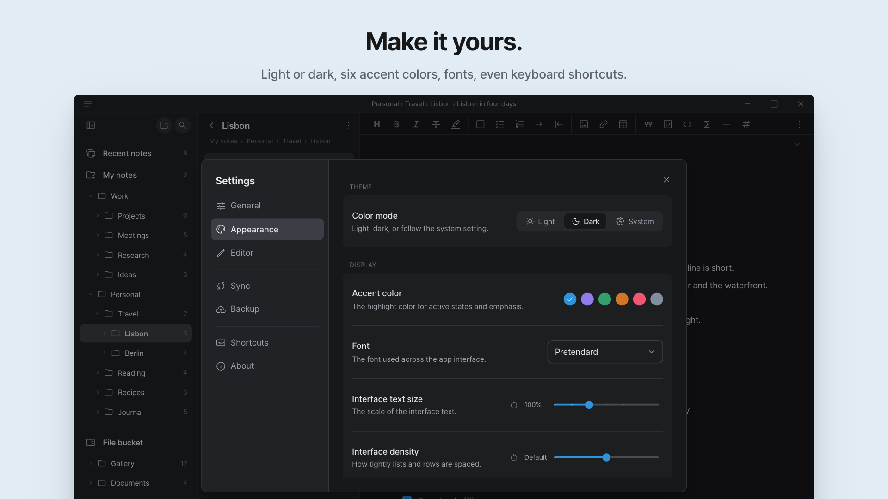

# Zutext

**My notes, safe yet free.**

Markdown notes with local-first storage and end-to-end encrypted sync — on macOS, Windows, Linux, iOS and Android.



## Install

### Linux

Zutext 2.0.0 for Linux (x86_64) is available from the [v2.0.0 release](https://github.com/support-zutext-com/zutext-releases/releases/tag/v2.0.0).

**Ubuntu / Debian** (Ubuntu 24.04 or later) — download `zutext_2.0.0_amd64.deb` and open it, or install it from the terminal:

```sh
sudo apt install ./zutext_2.0.0_amd64.deb
```

**Fedora** (Fedora 44) — download `zutext-2.0.0-1.fc44.x86_64.rpm` and open it, or install it from the terminal:

```sh
sudo dnf install ./zutext-2.0.0-1.fc44.x86_64.rpm
```

**Other distributions** — download and extract `zutext-2.0.0-linux-x86_64.tar.gz`.

## Features

- **Everything you write, in one place.** Markdown notes, end-to-end encryption when you want it, stored in your own cloud.
- **Built for serious notes.** Tables, code highlighting, math, Mermaid diagrams. All plain Markdown.
- **Turn it on, and not even the server can read them.** End-to-end encrypted sync with Argon2id and XChaCha20-Poly1305.
- **Two notes, side by side.** Split the window to compare and edit two notes at once.
- **Organized as you write.** Tasks, tags, and reminders collect themselves.
- **Rich text or source — your choice.** What gets saved is always Markdown — plain text.
- **Photos and files stay in your cloud.** Every attachment is saved to your own Google Drive or iCloud.
- **Take it anywhere.** Export to .md, .txt, .html, or .pdf whenever you like.
- **Make it yours.** Light or dark, six accent colors, fonts, even keyboard shortcuts.

## Screenshots













## Releases

Release builds and notes are published on the [Releases](../../releases) page.

## Support

Questions, bug reports or feedback: [support@zutext.com](mailto:support@zutext.com)
